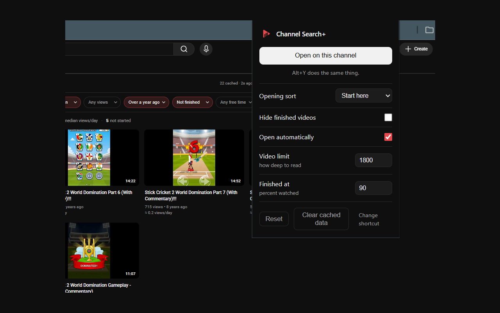

# Needle for YouTube

**The YouTube search that knows what you've watched.** A Chrome extension that
puts your watch history, Watch Later and Liked videos into YouTube's own search
bar, adds the filters YouTube leaves out (exact lengths, view counts, only what
you haven't seen), searches every upload on a channel, shows how long any
playlist is, and mutes a channel everywhere, search included.

This repository is private. The extension's code ships readable inside the
package, as every Chrome extension's does; what this repository adds is the
history, the checks and the tooling around it.

Formerly Channel Search+ for YouTube. Same extension, same listing, new name.

Free, with no paid tier. It runs entirely in your browser: no account, no API
key, no server, nothing sent anywhere.

**[Install it from the Chrome Web Store](https://chromewebstore.google.com/detail/needle-for-youtube-channe/magofcbhfhpfabphcldhodhgehhclokc)**

Guides, one per thing people search for: [search your watch history](https://gottostartsomewhere.github.io/needle/search-watch-history/),
[search your Watch Later](https://gottostartsomewhere.github.io/needle/search-watch-later/),
[block a channel, search included](https://gottostartsomewhere.github.io/needle/block-youtube-channel/),
[remove watched videos from Watch Later](https://gottostartsomewhere.github.io/needle/remove-watched-watch-later/),
[search inside any playlist](https://gottostartsomewhere.github.io/needle/search-youtube-playlist/),
[how long is a playlist](https://gottostartsomewhere.github.io/needle/youtube-playlist-length/),
[search every video on a channel](https://gottostartsomewhere.github.io/needle/search-youtube-channel/),
[a channel's longest video](https://gottostartsomewhere.github.io/needle/find-longest-video-youtube-channel/),
[filter search by views and exact length](https://gottostartsomewhere.github.io/needle/youtube-search-filters/).

## In the search bar

Start typing anywhere on YouTube. Matches from your history, Watch Later and
Liked videos show up above YouTube's own suggestions, with when you watched each
one and how far you got. Filters go straight into the query and are taken out
before YouTube sees it:

| Type | Gets you |
| --- | --- |
| `<20m` `>45m` | Length, exactly |
| `>100k` `<5k` | View count |
| `unwatched` `is:started` | Watch state |
| `is:fresh` | Nothing you were shown in an earlier search |
| `watched:august` | When you watched it |
| `in:history` `in:wl` `in:liked` | Only that list |
| `in:channels` | Every video from the channels you watch |
| `@name` `-@name` | From that channel, or never from it |
| `date:week` `after:2023` | Upload date |
| `sort:views` | Order |
| `lang:en` | Title language |
| `is:4k` `is:live` `has:subtitles` | YouTube's own filters, passed straight through |

Press Enter and anything YouTube can do itself goes to YouTube as its own
filter. The rest is applied to the results in the panel, which keeps reading
further down YouTube's results when a strict filter leaves too few. You can also
follow a search and see when something new matches it.

## Mute a channel, everywhere

YouTube's ⋮ menu on search results has no way to hide a channel, and its own
"Don't recommend channel" (elsewhere) never touches search. Needle adds **Mute
channel everywhere** to that same ⋮ menu on every video, and the channel goes
from search, Home, Subscriptions and the videos beside the one you're watching.
Its Shorts go too: YouTube's data does not say whose a Short is, so Needle asks
YouTube's public oEmbed address, the way any site embedding a video does.

Search says how many results it hid ("6 results from channels you muted,
hidden. Show them"). Mute words hide any title with that word in it. Undo is
on the toast, Unmute is in the same ⋮ menu, and the popup imports and exports
the list as text, so moving over from another blocker is one file.

A channel's own page, your own lists and the Shorts player are left alone:
somewhere you went on purpose is not noise.

## Your history, Watch Later and Liked

YouTube can't search inside Watch Later or Liked, and its history search only
takes words. Press the needle button on any of those pages and the same panel
opens over the list: filter by channel, length, views, upload date, when you
watched it and how far you got.

Page one of each list needs nothing special. Reading further back is **Deep
reading**, a switch in the popup that is off by default.
[PRIVACY.md](PRIVACY.md) explains exactly what it does before you turn it on.

On Watch Later the panel can also clean up. **Select** turns the cards into
checkboxes, with "pick everything the filters left" and "pick everything
finished" as shortcuts, and **Remove from Watch Later** sends YouTube's own
remove action after you confirm the number, with Undo straight after. It is the
one thing Needle can change on your account, so it is off until you allow it.

## Any playlist, and your subscriptions

The panel opens on any playlist page, yours or anybody's public one, and reads
the whole list rather than the first 100. Above the videos: its **Total
length**, and, signed in, **Left to watch** and how much is **Done**, from the
progress bars YouTube already draws. The total follows the filters, so
unwatched and under 15 minutes is how long the rest of a course really is. The
**Channel** picker lists who is in it and how many each has. `in:playlists` in
the search bar searches every playlist saved to your library at once.

**Play** turns what the filters left into a temporary YouTube playlist, and
Export copies the links (one per line, for NotebookLM), titles and links, a
Markdown list, CSV, JSON, or a link to the filter itself that opens the same
view for anyone with Needle.

From the popup, Home and video pages are a step away: Home offers your Watch
Later, history and subscriptions, a video page its channel, each opening with
the panel ready.

On your subscriptions page it filters the feed the same way: unwatched, under
twenty minutes, this week. And if you would rather not see what you have
already finished, the popup can dim or hide those videos on Home and
Subscriptions.

## The idea

Most in-page filter tools only touch the video cards already loaded on screen,
so they can sort what you have scrolled past and nothing more. This one pulls
the channel's complete catalogue through YouTube's internal InnerTube API before
it filters anything, so every sort, statistic, and chart covers all of it.
Questions like "what are this channel's least-viewed videos" or "what is the
median length across 1,200 uploads" are unanswerable from the loaded DOM, and
trivial here.

## On a channel

Open a channel's Videos tab and press the needle button, or Alt+Y. The panel
replaces the native grid in place, with a Close button to put things back.

Filter by title keyword, length band, view band, upload recency, and **watch
state**. That last one is the piece plain YouTube never gives you: hide
everything you have already finished, or pull up only the videos you started and
abandoned. Your progress rides along in the same payload the catalogue comes
from, so finding the unwatched half of a 900-video back catalogue takes one
dropdown.

Two more are built for the moment you actually want to watch something. **Start
here** is for landing on a huge channel cold: sorting by raw views just hands
you the oldest uploads, so it scores by views per day and caps how many come
from any one year, giving you the channel's best work spread across its life.
**Free time** takes the minutes you have and shows only what will fit. Set it to
20, set Watched to not started, and you have the answer to what should I watch
right now.

Sort by views, length, measured trend, or hidden gems, meaning
fast relative to the channel but still small in absolute terms. A summary line
recalculates as you filter.

## Insights

Everything analytical, behind one tab, in three sections. Insights only appear
on channel pages, since a channel is the only thing it can honestly describe.

**Overview.** Charts drawn from whatever the filters currently select: uploads
per year, median views by upload year, view and length distributions, and the
median views for each video length, which shows where a channel's sweet spot
is. Click any distribution bar to filter the grid by it. Underneath sits a
title-format table: which framings this channel's audience has responded to,
across questions, versus, numbered lists, how-to and superlatives. That last
one is the part YouTube Studio does not do even for your own channel, because
Studio tells you what performed and never which pattern performed.

**Compare.** Read any other channel's full catalogue and set its median views,
length, and top performers against this one.

**Watchlist.** Track a set of channels. Refresh reads all of them and gives you
two things: what is working right now, and content gaps, the topics they rank
for that this channel never has. Once a tracked channel has been refreshed
twice, "what is working" ranks by measured velocity, how fast each video is
moving relative to how fast that channel normally moves, so a small channel's
breakout can outrank a big channel's average upload.

A channel with no second reading yet cannot be measured at all, so it is not
pretended otherwise: those entries are simply that channel's biggest uploads of
the last 90 days, ranked by view count, sorted below every measured row. They
used to be ranked on lifetime pace, views over days since upload, which on a
real channel returned a list ordered purely by recency and inversely by views,
because a day-old video divides by one.

Alongside that: catalogues cache locally so re-opening is instant, refreshing
flags uploads added since your last visit, and any filtered set exports to CSV
or JSON.

## What it will not tell you

Several things that a catalogue like this can be made to say were taken out,
because they read as findings without being able to support the weight.

There is no per-word lift table. Ranking every word in a catalogue by the
median views of the videos containing it surfaces whichever words happened to
land on hits, and no sample-size floor fixes that, because the problem is not
the sample. A word does not cause views, its subject does, and there is no
move on the other end: you cannot put "zombies" in a title about phones.
Title-format analysis survived the same question, since eight categories fixed
in advance are eight hypotheses rather than a search through the corpus, and
"try a question" is a change someone can actually make.

There is no rising-or-fading verdict on a channel. Views are cumulative, so a
video from 2020 has had six years to collect them and one from 2025 has had
one. A channel performing identically every year still slopes downward on that
chart. Views per day only inverts the bias, because a recent upload sits inside
its launch spike. The honest metric is views in the first thirty days by year,
and that needs per-video history nobody has retroactively. The chart stays,
because where a channel's strongest years sit is worth seeing. The verdict on
top of it does not, and the bias is named on the card so it can be discounted.

Cards carry no outlier badge. It divided a recent upload's launch spike by a
lifetime average made mostly of old videos, so a badge reading "376x" was
largely reporting that the video was new. A sort can rank the same videos
without printing a figure that cannot be defended.

Nor is there a title-length chart, which had no mechanism behind it in the
first place.

## Measured velocity

Every refresh stores a snapshot of every video's view count with a timestamp.
Diff two snapshots and you get something the relative dates cannot give you:
real, measured growth. "Gained 380K views in the last 4 days" is observed, not
inferred. The tool gets more useful the more often you open it, and the history
is yours alone, kept locally.

Listing view counts carry two significant figures, so a video showing 2.4M moves
in steps of 100,000. Growth below one step is invisible, and a single step
across a boundary is indistinguishable from 100,000 real views. Anything that
could be explained by that rounding is discarded rather than recorded, which
costs visibility into ordinary movement on large videos and buys the guarantee
that a reported jump is a real one.

## How it works

The in-channel search box is a server-side InnerTube request that only matches
text, so every metric has to be computed client-side. The extension:

1. Reads the channel's `/videos` HTML and pulls `ytInitialData` along with the
   InnerTube key and client version.
2. Walks the uploads grid with continuation tokens against `/youtubei/v1/browse`,
   reading each video's id, title, duration, view count, and relative date. All
   of that already lives in the list payload, so there is no per-video request.
3. Filters, analyses, and renders everything locally.

Every request is same-origin from the YouTube tab, so it rides your normal
session and needs no API key of your own.

## Install

**[Install from the Chrome Web Store](https://chromewebstore.google.com/detail/needle-for-youtube-channe/magofcbhfhpfabphcldhodhgehhclokc)**

Works in Edge and other Chromium browsers from the same listing.

To run it from source instead:

Run `node build.js` first. It has no dependencies and writes `dist/chrome` and
`dist/firefox`, which differ only in the manifest, plus a zip of each for store
submission.

**Chrome or Edge.** Open `chrome://extensions` (or `edge://extensions`), turn on
Developer mode, choose Load unpacked, and select `dist/chrome`.

**Firefox.** Open `about:debugging`, choose This Firefox, then Load Temporary
Add-on, and pick the `manifest.json` inside `dist/firefox`.

Then open any channel's Videos tab, for example `youtube.com/@mkbhd/videos`, and
click the needle button at the bottom right, or press Alt+Y.

Clicking the toolbar icon opens the panel on the channel you are looking at and
holds the settings: how deep to read a channel, what counts as finished, which
sort to open on, and whether to hide watched videos or open automatically.
Changes save as you make them. The shortcut can be rebound at
`chrome://extensions/shortcuts`.

## Layout

The panel is plain JavaScript with no build step and no dependencies. Chrome
loads content scripts in order into a single shared scope, so the modules below
are ordinary scripts rather than ES modules, and the order in the manifest is
load-bearing.

| File | Holds |
| --- | --- |
| `src/arrive.js` | Runs before YouTube's own scripts, to catch a shared link's filters before YouTube rewrites the address. |
| `src/cards.js`, `src/feedmap.js` | In the page's own world from the start: read who made each video from YouTube's own data, for Mute. |
| `src/core.js` | Settings, parsers, and the InnerTube catalogue reader. No DOM. |
| `src/grid.js` | Runtime state, the filter and sort pipeline, the video grid. |
| `src/store.js` | IndexedDB cache, view-count snapshots, stats, export. |
| `src/library.js` | Your history, Watch Later and Liked, cached for the search bar, and the query grammar. |
| `src/memory.js` | What you've been shown (`is:fresh`), muted channels, followed searches, the channel index. |
| `src/charts.js` | SVG charts and the Overview section. |
| `src/analysis.js` | Channel comparison and title-format analysis. |
| `src/niche.js` | Watchlist, cross-channel outliers, view switching. |
| `src/panel.js` | Panel construction, grid takeover, startup. |
| `src/omnibar.js` | Needle's section in YouTube's search dropdown, and the typed filters. |
| `src/mute.js` | Mute everywhere: finding each video's card and channel, the ⋮ menu row, Shorts through oEmbed. |
| `src/navigate.js` | Runs in the page's own world so clicks open without a reload. Loaded separately. |

`background.js` relays the keyboard shortcut into the page and sets the toolbar
badge for followed searches, and
`popup.*` is the toolbar popup. `docs/design-preview.html` renders the real
panel against generated data, so the design can be checked without hunting for
a channel with the right shape of history.

`server/` is **not part of the extension** and never ships. `build.js` copies
only the paths in its `SHARED` list, and that directory is not among them, so
nothing in it reaches `dist/` or either store package. It holds a local Node
experiment into whether a scheduled poller could measure what the extension
structurally cannot, since the extension only observes while a tab is open. Its
findings fed back into the shipped rounding floor. See
[server/README.md](server/README.md).

One permission note worth knowing before anyone trims the manifest. The
extension asks for `host_permissions` on `www.youtube.com`, which looks
redundant given every fetch is same-origin from a YouTube page. It is not.
`chrome.tabs.query` leaves `url` undefined unless the extension holds either
the `tabs` permission or a host permission matching that tab, and both
`background.js` and `popup.js` read `tab.url` to tell whether the active tab is
a channel. Dropping the host permission would silently break the keyboard
shortcut and the popup, with no error to explain it. The `tabs` permission
would also work and is broader, showing a browsing-history warning at install,
so the narrower of the two is the one requested.

The content scripts share one scope, so a function declared in two files does
not fail: the later one silently replaces the earlier. That broke every panel
menu once (two `closeMenu`s). `tools/names-check.js` refuses it now.

## Checks

`node tools/check-all.js` before every upload: names declared twice, YouTube
pages saved earlier, YouTube's live data, the guide site, then a real Chrome on
live YouTube with the extension's own source loaded, signed out and signed in.
About ten minutes, and every part has to pass.

- `tools/browser-check.js --only="word|other"` reruns just the checks with
  those words in their names.
- `tools/browser-check.js --edits` adds the checks that change your account and
  put it back (remove from Watch Later then Undo, the archive, unlike then like
  again, find deleted videos without removing them). Never run daily.
- `tools/browser-check.js --signin` opens Chrome on the check's own profile
  (`%LOCALAPPDATA%\NeedleCheck`) to sign in once.
- Two scheduled tasks run the data check (10:00) and the browser check (10:10)
  every morning and pop a notification on a failure, so YouTube changing a page
  is found here before a user finds it.

Every fix gets a check that fails on the old code.

## Releasing, the site, the listings

1. Bump `version` in `manifest.json` and `manifest.firefox.json`. Raise
   `WHATS_NEW_FROM` in `background.js` and the popup's What's new card only for
   a release worth a NEW badge.
2. `node tools/check-all.js`, then `node build.js` for `dist/chrome-<version>.zip`.
3. Upload it in the Chrome Web Store dashboard.

The guide site is `site/build.js`, built into `site/public`, which is its own
repository (`gottostartsomewhere/needle`, GitHub Pages). A guide for a feature
still in review carries `ships`, and stays off the site until `LIVE_VERSION`
reaches it. Bump `HOME_UPDATED` when a guide goes live. The privacy policy page
is built from `PRIVACY.md`; the store's privacy link points there.

The store description is `docs/store-description.txt`, and in 50 other
languages `docs/listing/<lang>.txt`, pasted with `docs/listing/paste.html`
(ticks are kept per version). The summaries are `extDesc` in `_locales`, 132
characters at most, shipped in the package. `docs/listing/update-2.3.js` shows
how a release's changes go into all of them at once.

Store screenshots: `node tools/store-shots.js mute|playlist`, dark by default.

## Notes and limits

- Public view counts are all anyone gets for a channel they do not own, so this
  is a signal tool rather than a precision instrument. For other people's
  channels every tool is working from the same public numbers.
- Upload dates from InnerTube are relative ("6 months ago"), so Start here
  and the per-year charts are approximate. Measured velocity is not, because it
  comes from your own snapshots.
- Velocity needs at least two visits before it can show anything.
- Watch state comes from your signed-in session, so it is empty when signed out
  and it ages with the cache. Refresh to bring it up to date. A video counts as
  finished at 90 percent, which is roughly where YouTube stops offering a
  resume.
- Shorts carry no duration or upload date in their payload, so anything that
  depends on age or length is blank for them and they stay out of the main
  catalogue rather than moving every median in the product.
- The catalogue fetch is capped at 1,800 videos by default, adjustable in
  options. Refreshing a watchlist reads each channel in turn, so a large one
  takes a while.
- InnerTube is an unofficial endpoint. It is stable in practice, but YouTube can
  change the payload shape, which would call for a small parser update.

## Roadmap

- Sparklines per video once a few snapshots have accumulated.
- Exact stats and likes through the official Data API, opt-in with your own key.

## Privacy

Nothing is collected, transmitted, or sold. Catalogues, snapshots and watchlists
stay in your browser. The policy is [PRIVACY.md](PRIVACY.md), published as
<https://gottostartsomewhere.github.io/needle/privacy/>, which is the link the
store and the popup use. Change one, and the site build carries it to the other.

## License

PolyForm Noncommercial 1.0.0. See [LICENSE](LICENSE). It covers the code as it
ships inside the extension too: nobody may sell it or ship it inside something
they sell.
